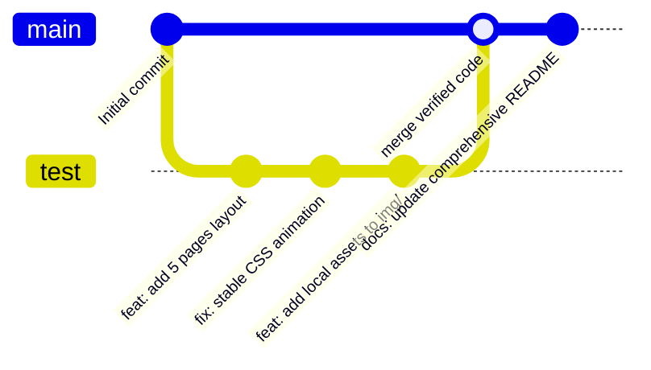

# 🎓 Интерактивный исторический портал «Chronos»

### 📝 Описание проекта
«Chronos» — это адаптивный многостраничный сайт-архив, посвященный великим историческим эпохам человечества (Античность, Средневековье, Древняя Русь). Проект разработан в рамках лабораторной работы в строгом соответствии с требованиями к семантической разметке, кроссбраузерной стабильности и контролю версий.

---

### 🚀 Функциональность и технический стек
* 🏛️ **HTML5:** Чистая семантическая разметка (`<header>`, `<nav>`, `<section>`, `<footer>`).
* 🎨 **CSS3 (Адаптивный дизайн):** Полная отзывчивость для мобильных устройств (`@media`), сетки карточек (`Grid Layout`), гибкие блоки (`Flexbox`) и стабильная плавная анимация появления страниц без мерцания.
* ⚡ **Vanilla JavaScript:** Обработка событий отправки форм обратной связи скриптория.
* 💾 **Сохранение состояния:** Реализована интеграция с браузерным хранилищем `localStorage` для фиксации имени последнего исследователя.
* 📦 **Git & GitHub Pages:** Интеграция с системой контроля версий и бесплатный хостинг.

---

### 📁 Структура проекта
В соответствии с регламентом, архитектура файлов имеет следующий вид:

```mermaid
graph TD
    A[my-web-site /] --> B[index.html - Главная]
    A --> C[about.html - О проекте]
    A --> D[blog.html - Блог эпох]
    A --> E[gallery.html - Галерея]
    A --> F[contact.html - Контакты]
    A --> G[README.md]
    A --> H[css /]
    A --> I[js /]
    A --> J[img /]
    H --> K[style.css]
    I --> L[script.js]
    J --> M[rome.jpg]
    J --> N[medieval.jpg]
    J --> O[rus.jpg]
    
    style A fill:#281f18,stroke:#d4af37,stroke-width:2px;
    style H fill:#241c15,stroke:#bfae99;
    style I fill:#241c15,stroke:#bfae99;
    style J fill:#241c15,stroke:#bfae99;
```

---

### 🔧 Рабочий процесс Git (Git Workflow)
Разработка велась изолированно. Вся новая функциональность, подбор локальных картинок и устранение моргания элементов изначально отлаживались в экспериментальной ветке `test`. Стабильный и проверенный код переносился в ветку `main` для последующего деплоя.

**История команд в терминале:**
1. Инициализация и переход в рабочую ветку: `git checkout -b test`
2. Фиксация изменений: `git add .` и `git commit -m "сообщение"`
3. Слияние: `git checkout main` -> `git merge test`
4. Пуш в облако: `git push origin main`

---

---

### 👥 Разработчики и Лицензия
* **Robert Freeman** — Фронтенд-археолог / Летописец-разработчик (Основная роль)
* **Лицензия:** MIT License — Проект открыт для академического использования.
